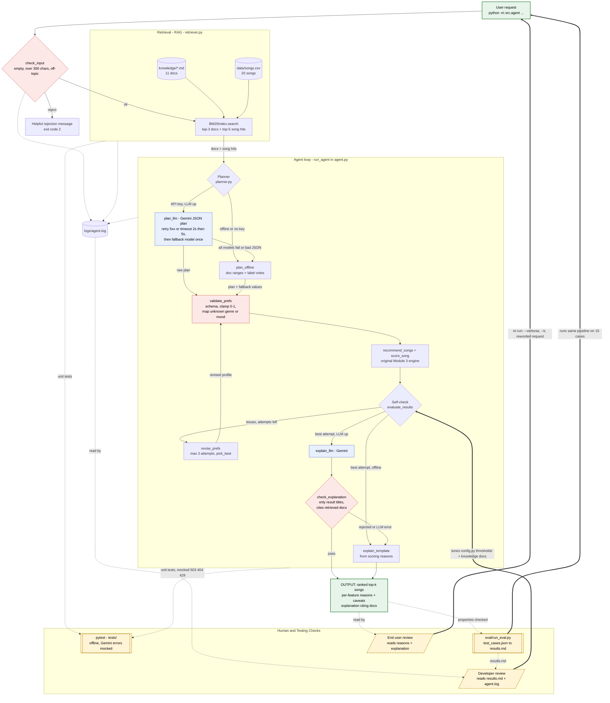

# VibeMatch Agent: An Applied AI Music Recommender

## Summary

VibeMatch turns a plain-English request such as "something chill for studying
on a rainy night" into ranked, explained song recommendations. It retrieves
relevant music knowledge, uses an AI agent to plan and check a listener
profile, and ranks songs with a transparent scoring engine. Guardrails check
the request, the plan and the final explanation. The result is a recommender
whose every pick can be traced to a score breakdown and a cited source. It is
covered by 118 automated tests and an evaluation suite, and it keeps working,
with clear warnings, when the AI model is overloaded, out of quota or
unavailable.

## Original Project

This project extends **"Music Recommender Simulation"** (CodePath AI110,
Module 3). The original was a content-based recommender: it scored each of 20
songs on genre, mood, energy, valence and acousticness, returned a ranked top
5, and showed how many points each feature contributed. Stretch features added
four switchable scoring modes, a diversity penalty for repeated artists and
genres, and a grid-table view. What motivated the extension: users had to
hand-write a Python profile dict, and genres or moods missing from the catalog
(like "k-pop" or "calm") matched nothing, with no warning.

## What's New

- **RAG retrieval:** a pure-Python BM25 retriever searches 11 knowledge docs
  (activities, mood families, genre notes) and the song catalog. The listener
  profile is built from what it finds.
- **Agentic loop:** each request goes through plan, validate, act, self-check
  and explain. The self-check can revise the profile up to twice.
- **Gemini with an offline fallback:** Gemini writes the plan and the
  explanation when available. Otherwise, deterministic rules build the plan
  from the same retrieved docs.
- **Guardrails:**
  - input checks for empty, too-long and off-topic requests;
  - plan validation that clamps out-of-range values and maps unknown genres
    and moods;
  - an output check that blocks explanations naming songs that weren't
    recommended.
- **Logging:** every step, retrieved doc, repair, retry and error goes to
  `logs/agent.log`. `--verbose` also prints them to the console.
- **Confidence score:** every result gets a computed 0-1 confidence (never
  self-rated by the LLM) with the reasons that lowered it.
- **Evaluation harness:** `python -m eval.run_eval` runs 15 property-based test
  cases and reports pass rate, consistency, confidence, repairs, retries and
  fallbacks. A human review sheet adds ratings of real outputs.

## Architecture Overview

The diagram source is [diagrams/architecture.mmd](diagrams/architecture.mmd),
and a rendered copy is at [assets/architecture.png](assets/architecture.png).



A request enters through `python -m src.agent`, and `check_input` either
rejects it with a helpful message or passes it to the BM25 retriever, which
returns the top 3 knowledge docs and the top 5 matching songs. The planner
turns those docs into a listener profile. It uses Gemini when available, with
retries and a fallback model, and deterministic rules when not. `validate_prefs`
repairs the profile before the original Module 3 engine (`recommend_songs` /
`score_song`) ranks the catalog. The self-check compares the results with the
request, loops back with a revised profile up to 3 attempts in total, and keeps
the best attempt. The explanation, from Gemini or a template, must pass
`check_explanation` before it reaches the user. Humans and tests check the AI
in the bottom row of the diagram: `pytest` unit-tests each component with
mocked Gemini errors, `eval/run_eval.py` runs the full pipeline on 15 cases, a
developer reads `eval/results.md` and `logs/agent.log` to tune thresholds and
knowledge docs, and the end user reads the reasons and can re-run or reword
the request.

## Project Structure

```text
applied-ai-system-project/
├── src/
│   ├── agent.py           # CLI + run_agent(): the agent loop (guardrail -> retrieve -> plan -> validate -> act -> self-check -> explain)
│   ├── retriever.py       # knowledge-base loader and pure-Python BM25 index
│   ├── planner.py         # Gemini planner (plan_llm) and offline rule-based planner (plan_offline)
│   ├── guardrails.py      # input check, plan validation/repair, explanation check
│   ├── selfcheck.py       # result checks, profile revisions, best-attempt choice
│   ├── confidence.py      # deterministic 0-1 confidence score
│   ├── explainer.py       # Gemini explanation and template explanation
│   ├── llm.py             # Gemini client: timeout, retries, fallback model, never raises
│   ├── labels.py          # catalog genres/moods and aliases from the knowledge base
│   ├── config.py          # thresholds and .env settings
│   ├── logging_setup.py   # logs/agent.log + optional console output
│   ├── recommender.py     # original Module 3 scoring engine (unchanged)
│   └── main.py            # original Module 3 CLI (unchanged)
├── knowledge/             # 11 markdown docs: activities, mood families, genre notes
├── data/songs.csv         # 20-song catalog
├── eval/                  # test_cases.json, run_eval.py, results.md, human_eval.md
├── tests/                 # 118 pytest tests (no network)
├── diagrams/              # architecture.mmd (Mermaid source)
├── assets/                # architecture.png
├── docs/                  # DESIGN.md (full design), ORIGINAL_PROJECT.md (Module 3 README)
├── model_card.md          # model card and reflection
├── requirements.txt
└── .env.example           # template for optional Gemini settings
```

## Setup

**Windows PowerShell**

1. Clone the repository:
   ```powershell
   git clone https://github.com/CarlitoTF99/applied-ai-system-project.git
   cd applied-ai-system-project
   ```
2. Create and activate a virtual environment. If activation is blocked, run
   `Set-ExecutionPolicy -Scope CurrentUser RemoteSigned` once.
   ```powershell
   python -m venv .venv
   .venv\Scripts\Activate.ps1
   ```
3. Install dependencies:
   ```powershell
   pip install -r requirements.txt
   ```
4. Copy the settings template:
   ```powershell
   Copy-Item .env.example .env
   ```
5. *(Optional)* Open `.env` and replace the placeholder value of
   `GEMINI_API_KEY` with your own key. Without a key the agent runs in offline
   mode and still gives full recommendations.
6. Check that everything works:
   ```powershell
   pytest
   ```

**macOS / Linux**

1. Clone the repository:
   ```bash
   git clone https://github.com/CarlitoTF99/applied-ai-system-project.git
   cd applied-ai-system-project
   ```
2. Create and activate a virtual environment:
   ```bash
   python3 -m venv .venv
   source .venv/bin/activate
   ```
3. Install dependencies:
   ```bash
   pip install -r requirements.txt
   ```
4. Copy the settings template:
   ```bash
   cp .env.example .env
   ```
5. *(Optional)* Open `.env` and replace the placeholder value of
   `GEMINI_API_KEY` with your own key. Without a key the agent runs in offline
   mode and still gives full recommendations.
6. Check that everything works:
   ```bash
   pytest
   ```

`.env` is git-ignored, so your key is never committed. The optional settings:

| Variable | Default | Meaning |
|---|---|---|
| `GEMINI_MODEL` | `gemini-3.5-flash-lite` | main model |
| `GEMINI_FALLBACK_MODEL` | `gemini-3.8-flash` | tried once if the main model fails (`none` turns it off) |
| `GEMINI_TIMEOUT` | `30` | seconds per attempt |

## Usage

**The agent:**

```bash
python -m src.agent "something chill for studying on a rainy night"
python -m src.agent "hype songs for the gym" --offline --verbose --k 3 --table
```

| Flag | Effect |
|---|---|
| `--offline` | never call Gemini, even if a key is set |
| `--verbose` | also print each step's log lines to the console |
| `--k N` | number of songs to return (default 5, range 1-20) |
| `--table` | show the results as a grid table |

The exit code is 0 on success, 2 when the input guardrail rejects the request,
and 1 on an unexpected error.

**The original Module 3 CLI** (unchanged; runs the built-in profiles):

```bash
python -m src.main
python -m src.main --mode mood-first --diverse --table
```

`--mode` accepts `balanced`, `genre-first`, `mood-first` or `energy-focused`.

**Tests:**

```bash
pytest
```

**Evaluation:**

```bash
python -m eval.run_eval
python -m eval.run_eval --llm --runs 1
```

The eval runs offline by default and writes `eval/results.md`. `--llm` uses
Gemini, at about 2 calls per case per run, so `--runs 1` helps stay within
free-tier quota.

## Sample Interactions

All output below is real: copied from the console or from `logs/agent.log`.
Long outputs are trimmed where marked.

### 1. "something chill for studying on a rainy night": LLM vs. offline

**LLM run.** The console output wasn't saved, so this is the run's trace from
`logs/agent.log` (run `4e4bf7`, trimmed). The main model was overloaded, so the
fallback model wrote both the plan and the explanation.

```text
step=retrieve | doc rainy_day.md score=5.742
step=retrieve | doc studying.md score=5.361
step=retrieve | doc road_trip.md score=2.185
step=plan     | Gemini gemini-3.8-flash attempt 1/3 failed after 13.12s: ServerError: 504 DEADLINE_EXCEEDED. [...]
step=plan     | Gemini gemini-3.8-flash attempt 2/3 failed after 13.14s: ServerError: 504 DEADLINE_EXCEEDED. [...]
step=plan     | Gemini gemini-3.8-flash attempt 3/3 failed after 0.34s: ServerError: 503 UNAVAILABLE. [...]
step=plan     | trying fallback model gemini-3.5-flash-lite
step=plan     | Gemini gemini-3.5-flash-lite attempt 1/1 succeeded in 0.77s
step=plan     | llm plan: {'favorite_genre': 'lofi', 'favorite_mood': 'chill', 'target_energy': 0.32,
                'target_valence': 0.55, 'likes_acoustic': True, 'mode': 'genre-first', 'diverse': False, [...]}
step=act      | attempt 1 top-3: Library Rain 8.38, Midnight Coding 8.17, Focus Flow 7.50 (max 8.5)
step=selfcheck| attempt 1 passed self-check
step=explain  | Gemini gemini-3.5-flash-lite attempt 1/1 succeeded in 0.91s
step=explain  | LLM explanation passed output guardrail
```

The explanation the model wrote, which passed the output guardrail:

```text
Here are some chill lofi tracks tailored for your study session tonight, matching your need for a calm
atmosphere [rainy_day.md].

Library Rain by Paper Lanterns hits the mark with an exact genre match for lofi, a perfect chill mood, and
high acousticness that fits your preferences. Midnight Coding by LoRoom also features a great lofi genre
match and a relaxed chill mood with low, steady energy levels ideal for deep focus [studying.md]. Finally,
Focus Flow by LoRoom brings a supportive focused mood family match alongside strong lofi elements to keep
you locked into your work without distractions.
```

**Offline run:**

```bash
python -m src.agent "something chill for studying on a rainy night" --offline
```

```text
================================================================
VibeMatch Agent  |  plan: offline  (--offline)
Request: "something chill for studying on a rainy night"
================================================================

[1] Retrieved knowledge docs
    rainy_day.md       score 5.74   (context)
    studying.md        score 5.36   (context)
    road_trip.md       score 2.19   (context)
    song evidence: Library Rain (3.87), Midnight Coding (3.70), Night Drive Loop (2.49), Rust in the Rain (2.10), Velvet Hours (1.85)

[2] Profile (attempt 1)
    genre=lofi | mood=chill | energy=0.41 | valence=0.53 | acoustic=yes
    mode=balanced | diverse=no

[3] Repairs
    - none

[4] Self-check (1 attempt(s), using #1)
    #1 initial plan
       top: Midnight Coding 8.33/8.5 -> pass

[5] Top 5 recommendations
----------------------------------------------------------------
1. Midnight Coding - LoRoom                    Score: 8.33 / 8.5
     + genre match: lofi (+2.50)
     + mood match: chill (+2.00)
     + energy 0.42 vs target 0.41 (+2.00)
     + valence 0.56 vs target 0.53 (+1.48)
     + acousticness 0.71, likes acoustic (+0.35)
2. Library Rain - Paper Lanterns               Score: 8.25 / 8.5
     + genre match: lofi (+2.50)
     + mood match: chill (+2.00)
     + energy 0.35 vs target 0.41 (+1.91)
     + valence 0.60 vs target 0.53 (+1.41)
     + acousticness 0.86, likes acoustic (+0.43)
[... #3 Focus Flow 7.32, #4 Spacewalk Thoughts 6.58, #5 Coffee Shop Stories 5.66 trimmed ...]

[6] Explanation (template)
    Based on [rainy_day.md, studying.md, road_trip.md], I looked for lofi / chill songs around energy 0.41 and valence 0.53 with an acoustic sound.
    #1 Midnight Coding by LoRoom: genre match: lofi, mood match: chill, energy 0.42 vs target 0.41.
    #2 Library Rain by Paper Lanterns: genre match: lofi, mood match: chill, energy 0.35 vs target 0.41.
    [... #3-#5 trimmed ...]

[7] Confidence: 0.99 (high) - top score 98% of max, no repairs, no retries
    lowered by:
      -0.01 top score only 98% of max
```

| | Offline | LLM (gemini-3.5-flash-lite) |
|---|---|---|
| Docs used | rainy_day, studying, road_trip | same 3 docs, given in the prompt |
| `target_energy` | 0.41 | **0.32** |
| `mode` | balanced | **genre-first** |
| #1 song | Midnight Coding (8.33) | **Library Rain (8.38)** |
| Explanation | template, built from scoring reasons | natural prose citing 2 docs, passed the guardrail |

Both plans come from the same retrieved docs. The offline average gets pulled
up by `road_trip.md`, which matched only on the word "night". The LLM gave that
doc less weight and picked a quieter target, so Library Rain moved to #1.

### 2. "hype songs for the gym"

```bash
python -m src.agent "hype songs for the gym" --offline
```

```text
[1] Retrieved knowledge docs
    workout.md         score 5.14   (context)
    mood_driven.md     score 2.58   (mood)
    song evidence: Gym Hero (2.66)

[2] Profile (attempt 1)
    genre=pop | mood=energetic | energy=0.89 | valence=0.62 | acoustic=no
    mode=energy-focused | diverse=no

[3] Repairs
    - favorite_mood 'hype' -> 'energetic' (alias from knowledge base)

[4] Self-check (1 attempt(s), using #1)
    #1 initial plan
       top: Gym Hero 7.39/8.5 -> pass

[5] Top 5 recommendations
----------------------------------------------------------------
1. Gym Hero - Max Pulse                        Score: 7.39 / 8.5
     + genre match: pop (+1.50)
     + mood family match: intense ~ energetic (+0.75)
     + energy 0.93 vs target 0.89 (+3.92)
     + valence 0.77 vs target 0.62 (+0.75)
     + acousticness 0.05, prefers non-acoustic (+0.47)
2. Sunrise City - Neon Echo                    Score: 6.22 / 8.5
3. Fuego en la Plaza - Los Faroles             Score: 6.17 / 8.5
4. Storm Runner - Voltline                     Score: 5.96 / 8.5
5. Concrete Psalms - Verse Theory              Score: 5.80 / 8.5
[trimmed: header, reasons for #2-#5, explanation]
```

The top doc is `workout.md`, so the planner chose `energy-focused` mode, and
all five songs have energy between 0.80 and 0.93. "Hype" isn't a catalog mood,
so the validator mapped it to `energetic` using the alias list in
`mood_driven.md`, and the repair is shown to the user.

### 3. "k-pop for a party" (genre repair)

```bash
python -m src.agent "k-pop for a party" --offline
```

```text
[1] Retrieved knowledge docs
    party.md           score 5.17   (context)
    genre_notes.md     score 4.21   (genre)
    mood_bright.md     score 1.12   (mood)

[2] Profile (attempt 1)
    genre=pop | mood=happy | energy=0.81 | valence=0.83 | acoustic=no
    mode=energy-focused | diverse=no

[3] Repairs
    - favorite_genre 'k-pop' -> 'pop' (alias from knowledge base)

[5] Top 5 recommendations
----------------------------------------------------------------
1. Sunrise City - Neon Echo                    Score: 8.41 / 8.5
     + genre match: pop (+1.50)
     + mood match: happy (+1.50)
     + energy 0.82 vs target 0.81 (+4.00)
     + valence 0.84 vs target 0.83 (+1.00)
     + acousticness 0.18, prefers non-acoustic (+0.41)
2. Rooftop Lights - Indigo Parade              Score: 7.46 / 8.5
3. Gym Hero - Max Pulse                        Score: 6.27 / 8.5
[trimmed: header, self-check, #4-#5, reasons, explanation]
```

In Module 3, a "k-pop" profile silently earned zero genre points from every
song, and its best score was 5.87 / 8.5. Now `genre_notes.md` is retrieved, its
alias list maps k-pop to pop, the repair is logged and shown, and the top song
scores 8.41 / 8.5.

### 4. Guardrail rejections

```text
PS> python -m src.agent "" --offline
Tell me what you'd like to hear, e.g. 'upbeat songs for a road trip'.
(exit code 2)
PS> python -m src.agent "what's the weather tomorrow" --offline
I can only help with music recommendations - try describing a mood, activity, or genre.
(exit code 2)
```

Both requests are stopped by deterministic checks before any retrieval or LLM
call: one is empty, and the other contains no music words and matches no
knowledge doc. The user gets a helpful message instead of made-up
recommendations or a stack trace.

## Design Decisions

- **The LLM plans and explains; a deterministic engine ranks.** Gemini never
  picks songs. It produces a profile that `score_song` scores against the
  catalog, so every ranking can be reproduced and unit-tested, and every score
  has a breakdown. *Trade-off:* results are less "creative" than letting a
  model pick freely.
- **Pure-Python BM25 instead of embeddings.** There are no heavy dependencies
  or vector stores, and every retrieval score can be read and explained.
  *Trade-off:* matching is purely lexical. For example, `road_trip.md` is
  retrieved for a study request just because of the word "night".
- **The offline planner uses the same retrieved docs.** It builds the profile
  from score-weighted doc ranges and label votes, so the system always works,
  even with no key, no network or no quota, and tests are fully reproducible.
  *Trade-off:* its profiles are less nuanced than the LLM's (energy 0.41 vs.
  0.32 in Sample 1).
- **The validator repairs and clamps instead of rejecting.** An LLM's
  `target_energy: 1.4` is clamped to 1.0 and "k-pop" is mapped to "pop", so
  the user still gets an answer. *Trade-off:* a repair can guess wrong, so
  every repair is logged and shown under `[3] Repairs`.
- **The self-check keeps the best attempt, not the last.** Attempts are ranked
  by number of issues, then by size of violation, then by order. The score
  ratio is deliberately not used, because the eval showed that a label swap
  can score higher while fitting the request worse. *Trade-off:* when no
  attempt is clean, the user gets the least-bad list plus a caveat rather than
  a perfect answer.
- **A lite Gemini model is the primary, with retries only for timeouts and 5xx
  errors.** In development, the lite model answered in under 1 second while
  the larger model was returning 503/504 errors. 4xx errors (bad key, retired
  model, quota) are never retried, because retrying can't fix them.
  *Trade-off:* a smaller model may reason less well. The larger model is kept
  as a one-shot fallback.
- **The Module 3 engine is reused unchanged.** `recommender.py` and `main.py`
  weren't modified, and `python -m src.main` was checked byte-for-byte against
  its original output after every change. *Trade-off:* the agent has to work
  within the engine's limits, such as one genre and one mood per profile and
  no way to exclude a genre.

## Testing Summary

**118 of 118 pytest tests pass** (all offline; Gemini is replaced by fakes).
**15 of 15 eval cases passed (100%); offline consistency 100%; average
confidence 0.78.** **Human review: 5 of 6 passed (avg fit 4.5/5).**

The agent struggled in two different ways:
- **Conflicting or vague requests:** confidence dropped below 0.75 for "rock
  but not too loud" (0.44), "sad but energetic" (0.62) and "play me some songs"
  (0.71).
- **Cultural fit:** "k-pop for a party" got 0.94 confidence but failed human
  review (fit 2/5). Mapping k-pop to generic pop was logically correct, but it
  missed the vibe.

Accuracy improved after the evaluation exposed four bugs (see below):
explicit energy limits are now enforced, the best-attempt tie-break was fixed,
vague requests get sensible defaults, and a check confirms that a genre the
user names stays in the top 3.

### Automated evaluation

This table shows 10 of the 15 cases. The full report, with every case and its
details, is in [eval/results.md](eval/results.md).

| # | Test Input | Evaluation Criteria | Result | Confidence | Notes |
|---|---|---|---|---|---|
| 1 | something chill for studying on a rainy night | avg energy <= 0.5; #1 genre in lofi/ambient/jazz; acoustic = yes; no caveat; explanation grounded | Pass | 0.99 (high) | clean run |
| 2 | hype songs for the gym | avg energy >= 0.7; #1 genre in pop/rock/metal/hip-hop; acoustic = no; explanation grounded | Pass | 0.87 (high) | favorite_mood 'hype' -> 'energetic' |
| 6 | sad songs but not too slow | avg valence <= 0.45; a top-3 mood in sad/melancholy/moody; target energy >= 0.5; #1 energy >= 0.45 or caveat; explanation grounded | Pass | 0.66 (medium) | 2 self-check retries, used attempt #1; caveat shown |
| 7 | k-pop for a party | profile genre = pop; repair logged for 'k-pop'; avg energy >= 0.7; avg valence >= 0.65; explanation grounded | Pass | 0.94 (high) | favorite_genre 'k-pop' -> 'pop' |
| 8 | sad but energetic | target valence <= 0.4; target energy >= 0.5; a top-3 mood in sad/melancholy/moody/angry/dramatic; #1 energy >= 0.45 or caveat; explanation grounded | Pass | 0.62 (medium) | 2 self-check retries, used attempt #1; caveat shown |
| 9 | country songs about heartbreak | profile genre = country; profile mood = sad; country in top 3 or caveat; a top-3 mood in sad/melancholy/moody; explanation grounded | Pass | 0.66 (medium) | favorite_mood 'heartbreak' -> 'sad' |
| 10 | rock but not too loud | #1 energy <= 0.65 or caveat; rock in top 3 or caveat; explanation grounded | Pass | 0.44 (low) | 2 self-check retries, used attempt #3; caveat shown |
| 11 | play me some songs | caveat shown; explanation grounded | Pass | 0.71 (medium) | caveat shown |
| 12 | "" | rejected as empty | Pass | n/a (rejected) | rejected by `empty` guardrail before retrieval |
| 14 | what's the weather tomorrow | rejected as off_topic | Pass | n/a (rejected) | rejected by `off_topic` guardrail before retrieval |

Totals over 45 runs (15 cases x 3): 12 guardrail rejections, 18 repairs, 18
self-check retries, 12 runs with caveats, and 0 LLM fallbacks (the eval runs
offline). Case 9 passes every property but scores only 0.66: its #1 song is
blues, not country, and the confidence score catches what the pass/fail checks
don't.

### Human evaluation

I ran 6 requests offline and rated each one myself. The criteria: does it fit
the request's vibe, does the explanation mention only real results and match
their scoring reasons, and would I actually play these songs. The full sheet,
including each run's explanation and reasons, is in
[eval/human_eval.md](eval/human_eval.md).

| # | Request | Top 3 songs | Confidence | Fits request? (1-5) | Explanation accurate? (Y/N) | Pass/Fail | My notes |
|---|---|---|---|---|---|---|---|
| 1 | something chill for studying on a rainy night | 1. Midnight Coding - LoRoom<br>2. Library Rain - Paper Lanterns<br>3. Focus Flow - LoRoom | 0.99 (high) |5|Y|Pass|  Perfect for a study sesh |
| 2 | hype songs for the gym | 1. Gym Hero - Max Pulse<br>2. Sunrise City - Neon Echo<br>3. Fuego en la Plaza - Los Faroles | 0.87 (high) | 5|Y|Pass|It's definetly meant for a gym sesh  |
| 3 | sad songs but not too slow | 1. Rust in the Rain - Delta Marrow<br>2. Afterglow Static - Kaito Mere<br>3. Night Drive Loop - Neon Echo | 0.66 (medium) |5|Y  |Pass  |Good for a depressing day  |
| 4 | k-pop for a party | 1. Sunrise City - Neon Echo<br>2. Rooftop Lights - Indigo Parade<br>3. Gym Hero - Max Pulse | 0.94 (high) |2|N|Failed  |Failed to meet the vibes even though logically makes sense  |
| 5 | relaxing jazz for a dinner party | 1. Coffee Shop Stories - Slow Stereo<br>2. Focus Flow - LoRoom<br>3. Midnight Coding - LoRoom | 0.92 (high) |5| Y |Pass  |Meets the vibes of a cozy jazz dinner party  |
| 6 | music for a road trip with friends | 1. Dust Road Letters - June Harlan<br>2. Rooftop Lights - Indigo Parade<br>3. Sunrise City - Neon Echo | 0.87 (high) |5| y| Pass |Good for a roadtrip  |

The only failure, "k-pop for a party", had one of the highest confidence
scores (0.94). Confidence measures how well the results fit the profile the
agent built, not whether that profile captures what the listener meant. That
gap is why the human review is part of the evaluation.

### Reliability mechanisms

| Mechanism | Input | Behavior | Result |
|---|---|---|---|
| Input guardrail (empty) | `""` | Deterministic check, before retrieval or any LLM call | "Tell me what you'd like to hear, e.g. 'upbeat songs for a road trip'.", exit code 2 |
| Input guardrail (off-topic) | "what's the weather tomorrow" | No music words and no knowledge-doc match | "I can only help with music recommendations - try describing a mood, activity, or genre.", exit code 2 |
| Validator repair | "k-pop for a party" | Unknown genre mapped using the alias list in `genre_notes.md` | `favorite_genre 'k-pop' -> 'pop'`, shown to the user. #1 Sunrise City scores 8.41/8.5, up from 5.87 in Module 3 |
| Clamping | A plan with `target_energy: 1.4` (direct `validate_prefs` call) | Out-of-range values are clamped, because `score_song` raises an error outside 0-1 | `target_energy 1.4 clamped to 1`, and the run completes |
| Self-check retry | "sad songs but not too slow" | #1 song energy 0.33 is below the requested floor of 0.50, so 2 revisions are tried | Attempt 1 kept (smallest violation) plus a caveat that no song fits both style and energy; confidence 0.66 |
| Output guardrail | An explanation naming Library Rain for the gym results (direct `check_explanation` call) | Rejects any catalog title that isn't in the results | `mentions 'Library Rain', which is not in the results`, so the template is used. The live LLM explanation in run `4e4bf7` passed |
| LLM failure: 404 | Fallback model `gemini-2.5-flash-lite` (run `4df554`) | 404 "no longer available to new users" is **not retried** | Offline plan; same top 3 as the offline run (Midnight Coding 8.33) |
| LLM failure: 503/504 | Main model overloaded (run `4e4bf7`, plan step) | 504, wait 2s, 504, wait 5s, 503, then the fallback model | `gemini-3.5-flash-lite` succeeded in 0.77s |
| LLM failure: 429 | Quota exceeded (run `4e4bf7`, explain step) | 429 is **not retried**; the fallback model gets one attempt | Fallback succeeded in 0.91s; its explanation passed the output guardrail |
| LLM failure: all attempts | Every call 503/504 (run `3f3be6`) | 6 failed attempts across plan and explain | Offline plan and template explanation; correct top 3 (Midnight Coding 8.33, Library Rain 8.25, Focus Flow 7.32) |
| Confidence score | "rock but not too loud" vs. "something chill for studying on a rainy night" | Computed from score ratio, retrieval strength, repairs, retries and LLM fallback; never self-rated by the LLM | 0.44 (low: -0.20 top score only 66% of max, -0.20 two retries, -0.16 weak retrieval) vs. 0.99 (high) |

### What didn't work at first, and how it was handled

- **Gemini failures in live runs:** retired model names (404), server overload
  (503/504) and quota limits (429), all handled as shown in the table above.
  No request ever crashed.
- **Bugs the evaluation exposed.** My first eval passed 100% while these bugs
  existed, because its expectations were too loose. Stricter properties caught
  all four:
  - vague requests like "play me some songs" got a contradictory "ambient /
    angry" profile (alphabetical defaults); they now use catalog-majority
    labels plus a "general picks" caveat;
  - explicit limits like "not too slow" weren't enforced, because a top-3
    average hid a slow #1 song; the #1 song must now respect them, or the user
    gets a caveat;
  - the best-attempt tie-break let a label swap win ("hopeful" for a
    heartbreak request); it now prefers the smallest violation, then the
    earliest attempt;
  - a genre the user named could drop out of the top 3 with no warning; that
    is now checked.
- **Smaller fixes:**
  - "sad but **not too slow**" originally retrieved `sleep.md` because of the
    word "slow", so negated phrases are now removed from the retrieval query;
  - mood-family names mapped to different moods between runs, because Python
    sets have no fixed order; the knowledge docs now define each family's
    representative mood.
- **Threshold analysis:** the 55% low-confidence threshold never fired across
  31 probe requests, while bad profiles still scored 0.60-0.69. A score ratio
  measures fit to the *profile*, not to the *request*, so I kept the threshold
  and added checks against the request instead.

### What I learned

- An evaluation is only as good as its expectations. A suite that passes 100%
  can still miss real bugs, and a high-confidence answer can still fail a
  human.
- With a small model plus retries, fallbacks and an offline path, the system
  stays reliable even when the API isn't.
- A good error message says what the system couldn't do, instead of picking
  something and hiding the problem.

## Reflection

This project taught me that most of the work in an applied AI system is around
the model, not in it: deciding what the model is allowed to do, checking what
it returns, and planning for when it isn't there. Keeping the LLM out of the
ranking made every recommendation explainable and testable, and building the
evaluation showed me that passing tests and correct behavior aren't the same
thing until the tests ask the right questions. The real API failures I hit,
from overloaded servers to quota limits and retired model names, made
resilience feel like a core feature rather than an extra. Above all, I learned
to treat both my own code and the AI's output as something to verify, not
trust.

For a detailed reflection on AI collaboration, limitations, and responsible use, see the [Model Card](model_card.md).

## Original Project Details

The complete Module 3 README (scoring recipe, profile experiments, weight-shift
experiment, bias analysis and stretch features) is preserved in
[docs/ORIGINAL_PROJECT.md](docs/ORIGINAL_PROJECT.md).

## About This Project (Portfolio)

**Repo:** https://github.com/CarlitoTF99/applied-ai-system-project

This project shows that I build AI systems I can explain and trust, not just
ones that produce an answer. I extended a simple rule-based music recommender
into an agent that retrieves knowledge, plans a listener profile with an LLM,
checks its own results, and explains them, while keeping the original scoring
engine deterministic so every recommendation can be traced to exact points.
When the LLM failed in real ways (retired model names, server overloads and
quota limits), I designed retries, fallback models and an offline mode so the
system never breaks, and I measured reliability with automated tests, an
evaluation harness and my own human review. I used AI as a fast collaborator
but verified its choices against real output, and I care about documenting
limitations and bias as much as features.
