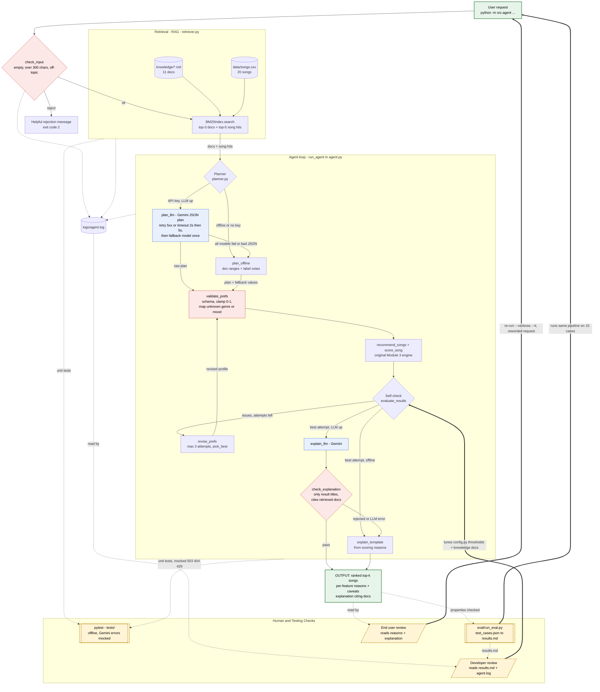

# VibeMatch Agent — Design

VibeMatch turns a natural-language request ("something chill for studying on a
rainy night") into song recommendations. Retrieval and an agentic loop sit in
front of the **existing, unchanged** `score_song` / `recommend_songs` engine in
`src/recommender.py`.

---

## 1. File / module layout

```
src/
  recommender.py      UNCHANGED  scoring engine (score_song, recommend_songs, max_score, MOOD_FAMILIES…)
  main.py             UNCHANGED  `python -m src.main` keeps working
  agent.py            NEW  CLI entry point + run_agent() orchestrator (steps a–g)
  retriever.py        NEW  doc loading, tokenizer, pure-Python BM25 index
  planner.py          NEW  plan_offline() + plan_llm() → raw user_prefs dict
  guardrails.py       NEW  check_input(), validate_prefs(), check_explanation()
  selfcheck.py        NEW  evaluate_results() + revise_prefs()
  explainer.py        NEW  explain_llm() + explain_template()
  llm.py              NEW  Gemini wrapper: timeout, retry/backoff, fallback model, JSON mode, never raises (§9)
  labels.py           NEW  catalog genres/moods + aliases and mood-family representatives from the KB
  config.py           NEW  load .env (python-dotenv), constants/thresholds
  logging_setup.py    NEW  file + optional console handlers
knowledge/            NEW  11 markdown docs (see §2)
logs/agent.log        NEW  created at runtime (logs/ is git-ignored)
eval/
  test_cases.json     NEW  15 requests with expected properties (see §12)
  run_eval.py         NEW  `python -m eval.run_eval`: pass rate, consistency, counters
  results.md          NEW  written by run_eval
tests/
  test_recommender.py UNCHANGED
  test_retriever.py   NEW  ranking sanity, empty query, scores sorted
  test_guardrails.py  NEW  input rejects, clamping, k-pop→pop, calm→chill
  test_planner.py     NEW  offline plans for canned requests
  test_agent.py       NEW  offline end-to-end, LLM failure → fallback (mocked)
  test_llm.py         NEW  retry/backoff/fallback-model policy (fake transport, no network)
  test_selfcheck.py   NEW  self-check issues, revisions, best-attempt choice
  test_eval.py        NEW  eval property checks + test-case file validity
.env.example          NEW  GEMINI_API_KEY, GEMINI_MODEL, GEMINI_FALLBACK_MODEL, GEMINI_TIMEOUT
.gitignore            EDIT add .env, logs/
requirements.txt      EDIT add python-dotenv, google-genai
```

`google-genai` is imported lazily inside `llm.py`. If the import fails or no key
is set, the agent runs in offline mode, so the offline path has no new
dependencies beyond `python-dotenv`.

---

## 2. Knowledge base (RAG corpus)

**11 markdown docs** in `knowledge/`. Each one starts with a small front-matter
block (parsed with plain string splitting, no YAML dependency) followed by 3–6
sentences of prose that the retriever indexes:

```markdown
---
type: context
energy: 0.20-0.45
valence: 0.45-0.70
acoustic: yes            # yes | no | any
genres: lofi, ambient, jazz, classical
moods: focused, chill, relaxed
keywords: study, homework, focus, concentrate, reading, exam
---
Studying music stays in the background: steady, low energy, few vocals…
```

| Doc | type |
|---|---|
| `studying.md`, `workout.md`, `rainy_day.md`, `party.md`, `sleep.md`, `road_trip.md` | context |
| `mood_calm.md`, `mood_bright.md`, `mood_driven.md`, `mood_low.md` (aligned with `MOOD_FAMILIES`, `turbulent` folded into driven/low) | mood |
| `genre_notes.md` (a short paragraph per catalog genre plus aliases such as "k-pop → pop", "hip hop → hip-hop", "edm → electronic") | genre |

Every `genres:` / `moods:` value in front matter **must** be a label that exists
in `songs.csv`. A test enforces this.

**Song catalog as documents.** Each CSV row also becomes a doc,
`song:<id>`, with text like
`"Library Rain Paper Lanterns lofi chill rainy cozy dreamy low-energy acoustic instrumental"`.
Numeric features become words using fixed bins (energy <0.4 low, 0.4–0.7 mid,
>0.7 high, plus the same bins for valence and acousticness).

**Retriever (`retriever.py`).** BM25 (k1=1.5, b=0.75) in roughly 60 lines of
pure Python. The tokenizer lowercases, splits on non-alphanumerics, keeps `-`
and `&` inside tokens (`hip-hop`, `r&b`) and drops a small stopword list. There
are two indexes:

- `kb_index` holds the knowledge docs. `retrieve(query, k)` returns `[(doc, score)]`.
- `song_index` holds the song docs. It supplies evidence for the planner and the label mapper.

Both return results sorted by descending score and drop zero-score hits.

---

## 3. Agent steps (input → output)

All steps share a `RunState` dataclass:
`request, run_id, docs, song_hits, prefs, repairs, attempts, results, explanation, mode_used ("llm"|"offline")`.

| Step | Input | Output | Notes |
|---|---|---|---|
| **a. Input guardrail** `check_input` | raw string | `ok` or `Rejection(message)` | rules in §5 |
| **b. Retrieve** | request, `k` | `docs` (top-k KB docs + scores), `song_hits` (top-5 songs + scores) | |
| **c. Plan** | request, `docs`, `song_hits` | raw prefs dict (untrusted) | LLM or offline, see below |
| **d. Validate** | raw prefs, `docs` | clean prefs + `repairs: list[str]` | rules in §5 |
| **e. Act** | clean prefs, `--k` | `recommend_songs(prefs, songs, k, mode, diverse)` | engine called as-is |
| **f. Self-check** | prefs, results, `docs` | `pass` or a revised prefs dict (back to **d**) | max 2 revisions, see §6 |
| **g. Explain** | request, results, doc names | explanation text | LLM, then output guardrail, then template fallback |

### c. Plan, LLM mode (`plan_llm`)
The prompt contains:
1. The role and the task.
2. The **allowed genres and moods**, listed from the catalog.
3. The retrieved docs (name, front matter, and the first ~400 characters of each).
4. The top song hits.
5. The JSON schema from §4 and the instruction "Return ONLY JSON."

The call uses `response_mime_type="application/json"` and temperature 0.2, and
follows the call policy in §9 (timeout, retries, fallback model). The output
still goes through `json.loads`, and any failure returns `None`, which triggers
offline mode.

### c. Plan, offline mode (`plan_offline`): deterministic, grounded in the retrieved docs
1. **Numeric targets.** `target_energy` and `target_valence` are the
   BM25-score-weighted mean of the midpoints of each retrieved doc's range.
2. **Genre and mood.** Each retrieved doc gives its listed genres and moods a
   vote equal to its score. Each top song hit adds half its score to its own
   genre and mood. The highest vote wins in each category. If the request names
   a catalog label explicitly ("jazz", "sad"), that label wins.
3. **`likes_acoustic`.** Score-weighted majority of the docs' `acoustic:` field,
   ignoring docs marked `any`.
4. **Modifier lexicon.** A small table applied last. For example: "not too
   slow" / "upbeat" raises the energy floor to ≥0.5; "slow" / "mellow" lowers
   energy by 0.15; "happy" raises valence by 0.15; "sad" lowers it by 0.15;
   "mix" / "variety" sets `diverse=true`.
5. **`mode`.** Set to `energy-focused` if an activity doc (workout, party)
   ranks first, `mood-first` if a mood doc ranks first, and `balanced`
   otherwise.

Each derived value is logged together with the docs it came from.

---

## 4. Plan JSON schema

```json
{
  "type": "object",
  "required": ["favorite_genre", "favorite_mood", "target_energy",
               "target_valence", "likes_acoustic"],
  "properties": {
    "favorite_genre": {"type": "string", "enum": ["<17 catalog genres>"]},
    "favorite_mood":  {"type": "string", "enum": ["<16 catalog moods>"]},
    "target_energy":  {"type": "number", "minimum": 0, "maximum": 1},
    "target_valence": {"type": "number", "minimum": 0, "maximum": 1},
    "likes_acoustic": {"type": "boolean"},
    "mode":    {"type": "string",
                "enum": ["balanced", "genre-first", "mood-first", "energy-focused"]},
    "diverse": {"type": "boolean"},
    "rationale": {"type": "string", "maxLength": 300}
  },
  "additionalProperties": false
}
```

The schema is written into the prompt for the LLM and enforced by hand in
`validate_prefs`, so there is no `jsonschema` dependency. `rationale` is logged
only and is removed before the prefs reach `recommend_songs`.

---

## 5. Guardrail rules

### a. Input guardrail (deterministic, no LLM)
| Rule | Result |
|---|---|
| Empty or whitespace-only | reject: "Tell me what you'd like to hear, e.g. 'upbeat songs for a road trip'." |
| Longer than 300 characters after stripping | reject: "Please keep requests under 300 characters." |
| **Not about music.** The request has no token from the music vocabulary (KB keywords, catalog genres/moods/tags, and a small list such as song, music, playlist, vibe, listen), **and** the best KB BM25 score is below `MIN_RELEVANCE` (1.0) | reject: "I can only help with music recommendations — try describing a mood, activity, or genre." |
| Control characters | stripped and logged; the request is not rejected |

A rejection exits with code 2 and is logged at INFO. It never raises.

### d. Validate / repair (`validate_prefs`)
Repairs are applied in this order. Each one appends a human-readable entry to
`repairs`, for example `"favorite_genre 'k-pop' → 'pop' (alias)"`.

1. Missing required key: fill it from the offline plan.
2. Unknown key: drop it.
3. Number given as a string: cast it. A value that can't be cast is replaced from the offline plan.
4. `target_energy` / `target_valence` outside [0, 1]: clamp. This is required,
   because `score_song` raises `ValueError` on out-of-range values.
5. `likes_acoustic` given as "yes"/"no"/0/1: coerce to bool.
6. `mode` not in `SCORING_MODES`: set to `balanced`. `diverse` that isn't a bool: set to `false`.
7. **Genre or mood not in the catalog.** This fixes the silent failures recorded in `model_card.md`.
   1. Normalize spelling (lowercase, `hip hop` → `hip-hop`).
   2. Look up the alias table from `genre_notes.md` (`k-pop` → `pop`, `edm` → `electronic`).
   3. For moods: if the value is a `MOOD_FAMILIES` key, use the family's first member (`calm` → `chill`, `low` → `sad`).
   4. Otherwise, query `song_index` with the bad label plus the request and take the genre or mood of the top hit.
   5. If retrieval returns nothing, use the first label listed in the top KB doc.

---

## 6. Self-check & retry logic

After each **Act**, `evaluate_results` produces a list of issues:

| Check | Condition |
|---|---|
| Low confidence | `top_score / max_score(prefs, mode) < 0.55` |
| Energy contradiction | the mean energy of the top 3 songs falls outside the top context doc's `energy` range by more than 0.15 (e.g. a "calm" request whose top songs have energy above 0.7) |
| Valence contradiction | the same comparison against the doc's `valence` range |
| Energy constraint | the request set an explicit energy floor or ceiling ("not too slow", "energetic", "not too loud") and the **#1 song** breaks it by more than 0.05. This is a hard check; the top-3 average can hide a violation. |
| Explicit miss | a genre or mood the user **named** (after alias mapping) is missing from the top 3, with related genres and same-family moods counting as present |
| Label miss | none of the top 3 songs match the profile's genre **or** mood, not even a related genre or a mood in the same family |

If no issues are found, the result passes. Otherwise `revise_prefs` makes **one
targeted change** per attempt and the revised prefs go back through **d → e → f**:

- **Attempt 2.** For an energy constraint, move the target 0.1 inside the
  violated limit. For an energy or valence contradiction, nudge the target 50%
  toward the doc range midpoint. Either way, switch to `energy-focused` mode.
  For an explicit miss or a label miss, switch to `genre-first` or `mood-first`
  mode, whichever label missed.
- **Attempt 3.** Swap `favorite_genre` (or mood) for the next-highest vote from
  the offline planner's tally. Labels the user named are never swapped.

The loop stops after **3 attempts in total** (the original plus 2 revisions).
The agent returns the attempt with the fewest issues. Ties go to the smallest
total violation, then to the **earliest** attempt. The score ratio is
deliberately not a tie-breaker: a label swap can score higher against its own,
less faithful profile while fixing nothing. The evaluation in §12 found this
with "country songs about heartbreak", where the swapped mood "hopeful" won.

If no knowledge doc matches (e.g. "play me some songs"), the planner uses
catalog-majority labels, or the labels that co-occur with the one it does know
(e.g. rap → hip-hop / confident), and the agent adds a "general picks" caveat. Every
attempt logs its prefs, top-3 songs with scores, the issues found and the
change made. Remaining issues are shown to the user as a short caveat (e.g.
"no song in the catalog is quieter than 0.28").

---

## 7. Explain + output guardrail

`explain_llm` prompt: the request, the final top-k (title, artist, score, the
reason strings from `recommend_songs`), the retrieved doc names, and any
caveats. The instructions say to write at most 120 words, mention only the
listed songs, and cite at least one doc name in brackets, e.g. `[studying.md]`.

`check_explanation` rejects the LLM text if any of these holds:
- It mentions a catalog title that is **not** in the results (the text is
  scanned for all 20 titles, case-insensitive).
- It mentions none of the result titles.
- It cites no retrieved doc name, or cites a doc that was not retrieved.
- It is empty or longer than 1,000 characters.

On rejection or LLM failure, `explain_template` builds the explanation from
data. Example:
`"Based on [studying.md, rainy_day.md] I looked for lofi / chill around energy 0.38. #1 Library Rain — genre match: lofi, mood match: chill, energy 0.35 vs target 0.38 …"`.

---

## 8. Logging

`logging_setup.configure(verbose)` creates the logger `vibematch` with:
- a **file handler** writing to `logs/agent.log` at DEBUG, always on (`RotatingFileHandler`, 1 MB × 3);
- a **console handler** that is off by default and runs at INFO with `--verbose`.

The line format is
`2026-11-15 12:00:00 | INFO | run=a1b2c3 | step=retrieve | <message>`.

| Step | Logged |
|---|---|
| start | run_id, request (truncated to 300 chars), flags, LLM available yes/no |
| a | pass or reject, plus the rule that fired |
| b | each doc and song hit with its BM25 score |
| c | mode (llm/offline), LLM latency, raw LLM text (DEBUG), parsed prefs, offline vote tallies (DEBUG) |
| d | every repair, final prefs |
| e/f | per attempt: prefs, top-3 and scores, issues, revision made |
| g | LLM or template, guardrail verdict and reason |
| errors | WARNING for every fallback (API error, timeout, bad JSON, guardrail fail); ERROR with traceback for anything unexpected |

---

## 9. Error handling

- **LLM call policy (`llm.py`).** Each LLM call (plan, explain) works through these steps in order:

  | Step | Rule |
  |---|---|
  | Main model | `GEMINI_MODEL` (default `gemini-3.5-flash-lite`). Each attempt times out after `GEMINI_TIMEOUT` seconds (default 30). |
  | Retries | Up to **2** retries, waiting **2s** and then **5s**, **only** for timeouts and 5xx errors (500 / 503 UNAVAILABLE / 504 DEADLINE_EXCEEDED). The SDK's own retries are turned off (`HttpRetryOptions(attempts=1)`). |
  | Never retried | Any **4xx**: 400 bad request, 401/403 bad key, 404 unknown model and **429 quota**. |
  | Fallback model | `GEMINI_FALLBACK_MODEL` (default `gemini-3.8-flash`; `none` disables it) gets **one** attempt if the main model still fails. It is skipped after an auth error, since every model would reject the key. A 404 marks the main model unusable, so later calls in the same run go straight to the fallback. |
  | Offline | If every model fails, the call returns `None` and the step uses its offline path (the offline plan or the template explanation). |

  Every attempt is logged with the model, `attempt n/N`, the error, the elapsed
  time and the retry decision. The worst case per call is
  3 × timeout + 7s + 1 × timeout. The fallback is per step: a failed plan call
  doesn't stop the agent from trying the LLM for the explanation, unless an
  auth error disabled the LLM for the rest of the run.
- Validation means `score_song` never sees bad input.
- `agent.main()` wraps `run_agent` in a final catch. On an unexpected error it
  logs the traceback, prints "Something went wrong — see logs/agent.log" and
  exits with code 1. A bad request never produces a stack trace.
- A missing or unreadable `knowledge/` directory logs a WARNING. Retrieval then
  falls back to the song index only, and the planner falls back to catalog-wide
  defaults.

---

## 10. CLI & config

```
python -m src.agent "sad songs but not too slow" [--offline] [--verbose] [--k 5] [--table]
```
- `--offline` skips the LLM even if a key is set.
- `--k` sets the number of songs (default 5, clamped to 1–20). The number of KB docs retrieved is fixed at 3.
- `--table` reuses `print_table` from `src/main.py`.

The output is the request summary, the retrieved docs, the final profile, a
repairs/attempts summary, the recommendations and the explanation.

`config.py` calls `load_dotenv()` and reads these settings. The key is never
logged. `.env.example` is committed and `.env` is git-ignored.

| Variable | Default |
|---|---|
| `GEMINI_API_KEY` | none; without it the agent runs offline |
| `GEMINI_MODEL` | `gemini-3.5-flash-lite` |
| `GEMINI_FALLBACK_MODEL` | `gemini-3.8-flash` (`none` disables it) |
| `GEMINI_TIMEOUT` | `30` seconds per attempt |

---

## 11. Data flow

The architecture diagram is in [`diagrams/architecture.mmd`](../diagrams/architecture.mmd), rendered at [`assets/architecture.png`](../assets/architecture.png). It reflects the code as implemented, including the human and testing checkpoints:



---

## 12. Evaluation harness

`python -m eval.run_eval` runs every case in `eval/test_cases.json` through
`run_agent`. It runs **offline** by default; `--llm` uses Gemini, at about 2
calls per accepted case per run, which free-tier quota may not cover, so use
`--runs 1` to save calls.

- **Cases.** There are 15: 5 normal, 6 edge (unknown genre, conflicting energy
  and mood, a named genre the catalog can't satisfy, a vague request) and 4
  rejects. Each case lists **expected properties**, not exact songs: average
  energy/valence bounds, allowed top-1 genres/moods, profile labels, a repair
  that must be logged, an expected rejection rule, and "honored **or**
  flagged" checks (`*_or_caveat`). Every accepted case is also checked for
  `explanation_grounded` (no catalog title outside the results).
- **Consistency.** Each case runs `--runs` times (default 3) and passes when
  every run has the same top 5, or the same rejection rule.
- **Counters.** Guardrail rejections, repairs, self-check retries, runs with
  caveats, and, with `--llm`, LLM plan/explanation fallbacks, Gemini API
  retries and fallback-model use.
- **Output.** A plain-ASCII summary on the console and `eval/results.md`
  (summary, a per-case table, and run-1 details for each case). The exit code
  is 1 if any case fails.
